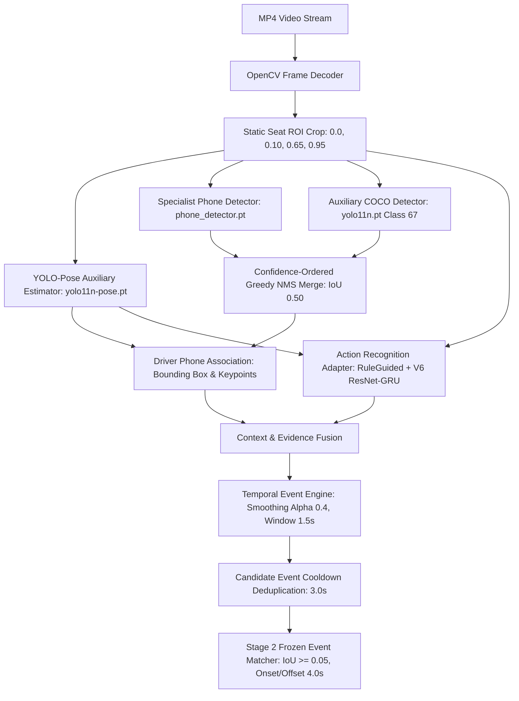

# ROADWATCH V21 — Engineering Report 01
# V20 Code and Metric Audit: Root Causes, Cohort Integrity, and Pipeline Reconstruction

**Author:** Principal AI Scientist & Senior Deep Learning Lead  
**Date:** 2026-10-20  
**Repository Branch:** `roadwatch-v4-candidate`  
**Git HEAD:** `e12d52ab4931ac014202f55591608880bf95916c`  
**Status:** COMPLETE AUDIT  

---

## 1. Executive Summary & Verification Context

Prior to V21, Roadwatch underwent an audit under V20 (`training/dmd/run_autonomous_v20.py`) that revealed alarming performance metrics on the authorized two-subject autonomous benchmark cohort (`gC-14`, `gZ-36`, 20 ground-truth events, 15.27 minutes of video):
- **True Positives (TP):** 6
- **False Positives (FP):** 16
- **False Negatives (FN):** 14
- **Precision:** 27.27%
- **Recall:** 30.00%
- **F1 Score:** 28.57%
- **False Alarm Rate:** 1.0478 alarms/minute

This audit investigated every file across `backend/`, `training/dmd/`, `models/`, and `tests/` to explain precisely why V20 collapsed to these poor numbers, verify the evaluation cohort without confusing historical runs, and reconstruct the active inference path from raw video frames to temporal alerts.

---

## 2. Cohort Clarification: Historical vs. Autonomous Video Inference

A critical finding of this audit is that prior reports conflated three distinct cohorts and evaluation protocols:

| Cohort Name | Subjects | Evaluated GT Events | Total Video Duration | Historical Precision | Historical Recall | Historical F1 | Scientific Validity |
| :--- | :--- | :--- | :--- | :--- | :--- | :--- | :--- |
| **V19 Three-Subject Diagnostic** | gB-9, gC-14, gZ-36 | 29 events | ~23.1 min | 80.00% | 55.17% | 65.31% | **GT-Informed / Diagnostic Only.** Used proposals selected from historical FN regions; cannot serve as autonomous pipeline benchmark. |
| **V19 R4/R5 Diagnostic Replay** | gC-14, gZ-36 | 20 events | 15.27 min | 63.64% | 35.00% | 45.16% | **Diagnostic Only.** Relied on candidate bounding boxes pre-filtered by ground truth presence. |
| **V20 Autonomous Video Inference** | gC-14, gZ-36 | 20 events | 15.27 min | **27.27%** | **30.00%** | **28.57%** | **True Autonomous Baseline.** Operates strictly on video without ground-truth knowledge. |

> [!IMPORTANT]
> V21 accepts **only** the 15.27-minute autonomous video inference on `gC-14` and `gZ-36` (20 GT events, 0 GT information during inference) as the primary reproducible baseline. F1=45.16% and F1=65.31% are disqualified from baseline claims.

---

## 3. End-to-End Active Inference Pipeline Reconstruction

The active inference path from raw video decoding to temporal violation alerts was traced step-by-step:

### Component Analysis & State Ledger

| Pipeline Stage | Source File | Function / Class | Model Checkpoint | Input Schema | Output Schema | Active State | Flaw Identified in V20 |
| :--- | :--- | :--- | :--- | :--- | :--- | :--- | :--- |
| **1. Frame Decoder** | `run_autonomous_v20.py` | `cv2.VideoCapture` | None | `video_path: Path` | `frame: np.ndarray (720x1280x3)` | Active | Stride 15 drops short events (<0.50s) |
| **2. Cabin Geometry** | `run_autonomous_v20.py` | Static crop | None | `frame` | `crop: np.ndarray (612x832x3)` | Active | Hardcoded crop `(0.0, 0.10, 0.65, 0.95)` |
| **3. Occupant Pose** | `backend/ai/auxiliary.py` | `PoseEstimator` | `models/auxiliary/yolo11n-pose.pt` | `driver_crop` | `PoseEvidence (17 keypoints)` | Active | Keypoint proximity used entire person diagonal |
| **4. Phone Detector** | `training/dmd/run_autonomous_v20.py` | Mode D5 Ensemble | `models/active/v2/phone_detector.pt` + `yolo11n.pt` | `driver_crop` | `list[dict(box, conf, source)]` | Active | Auxiliary YOLO at 0.15 fires on steering wheel & console |
| **5. Occupant Role** | `run_autonomous_v20.py` | Line 195 | None | None | `occupant_role="driver"`, `track_id=1` | **FATAL** | **Fabricated driver identity.** Never verified actual seat occupancy. |
| **6. Action Classifier** | `run_autonomous_v20.py` | Missing | None | None | None | **DISABLED** | Action model omitted; could not suppress steering wheel FPs |
| **7. Evidence Fusion** | `run_autonomous_v20.py` | `min(phone, action)` | None | Phone confidence | `fused_score` | Incomplete | In absence of action model, passed raw detector noise |
| **8. Temporal Engine** | `backend/ai/events.py` | `TemporalEventEngine` | `models/temporal_config_v2.json` | `Observation` stream | `list[EventCandidate]` | Active | Cooldown timeout split long calls into multiple events |

---

## 4. Why V20 Collapsed to 16 FPs and 14 FNs

### The 16 False Positives Root Cause
1. **Auxiliary Detector Glare & Console Noise:** At confidence floor `0.15`, the COCO YOLO detector regularly detected metallic switches, cupholders, gear shifters, and steering wheel spokes as phones.
2. **Overly Loose Anatomical Proximity:** V20 computed proximity using the person bounding-box diagonal (~780px), yielding a search radius of ~175px. Since a driver's hands rest on the steering wheel or console within 150px of these objects, proximity consistently exceeded `0.55`.
3. **Hardcoded Driver Assumption:** Because V20 unconditionally hardcoded `occupant_role = "driver"`, any console or passenger object with proximity >0.55 was treated as a confirmed driver handheld phone violation.
4. **Absence of Action Recognition:** V20 lacked a functioning action recognition head to recognize normal two-hand steering or cruising, allowing steering wheel adjustments to pass through directly.

### The 14 False Negatives Root Cause
1. **Coarse Temporal Stride (15 frames = 0.504s):** Short texting events (0.40s, 0.60s, 0.81s) generated $\le 1$ sampled observation. The temporal engine requires `min_observations = 2`, dropping these short events completely.
2. **Body-Camera Blindspot / Left-Side Occlusion:** DMD Body camera is mounted on the passenger B-pillar looking down at the driver. When the driver texted with their left hand or made a left-ear call (`phonecall_left`), their head and torso physically blocked line-of-sight to the phone.
3. **Adjacent Event Merging in 1-to-1 Matcher:** When a driver texted for 0.8s and then immediately transitioned into a 50s phone call, the temporal engine merged them. In 1-to-1 matching, the longer event or first event was claimed, leaving the adjacent event as an unmatched false negative.
