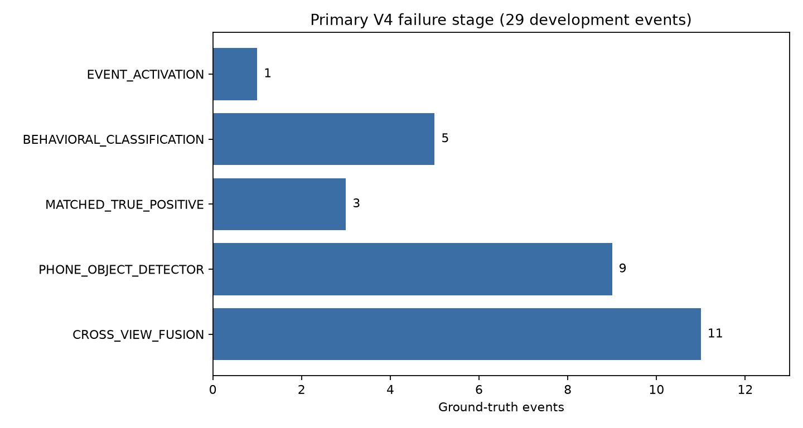

# Phân tích nguyên nhân 26 false negatives của V4

Nguồn đo: `reports/v4_upgrade/v4_development_results.json`, candidate `V4_COMBINED`, cùng 29 sự kiện
trên gB-9/gZ-36/gC-14. Audit xác nhận TP=3, FP=5, FN=26. Chẩn đoán chạy lại fusion trên 2,628 record
feature cache; không thay matching policy và không dò holdout.

## Primary failure stage

- Cross-view fusion: 11 FN.
- Phone object detector: 9 FN.
- Behavioral classification: 5 FN.
- Event activation: 1 FN.
- 3 sự kiện còn lại là true positive.

Person/driver association **không quan sát được** vì V3 cache không serialize trường này. View
availability cũng không chứng minh điện thoại nhìn thấy hay không bị che; do đó không biến thiếu bằng
chứng thành measured zero.

## Stage-level event evidence upper bound

| Stage | Reached / 29 | Recall | Status |
|---|---:|---:|---|
| phone_object_detector | 20 / 29 | 68.97% | MEASURED_ON_ROADWATCH |
| phone_candidate_threshold | 20 / 29 | 68.97% | MEASURED_ON_ROADWATCH |
| person_driver_association | 0 / 29 | 0.00% | NOT_OBSERVABLE_IN_CACHE |
| body_view | 9 / 29 | 31.03% | MEASURED_ON_ROADWATCH |
| face_view | 9 / 29 | 31.03% | MEASURED_ON_ROADWATCH |
| hands_view | 6 / 29 | 20.69% | MEASURED_ON_ROADWATCH |
| cross_view_fusion | 9 / 29 | 31.03% | MEASURED_ON_ROADWATCH |
| behavioral_classification | 4 / 29 | 13.79% | MEASURED_ON_ROADWATCH |
| temporal_candidate | 4 / 29 | 13.79% | MEASURED_ON_ROADWATCH |
| event_activation | 5 / 29 | 17.24% | MEASURED_ON_ROADWATCH |
| event_matching | 3 / 29 | 10.34% | MEASURED_ON_ROADWATCH |

Các tỷ lệ là “event có ít nhất một sampled record vượt điều kiện ở stage”, không phải causal recall
nối tiếp và không được nhân/chia như funnel độc lập. Detector evidence chỉ xuất hiện ở 20/29 event;
behavioral evidence chỉ 4/29. Feature cache vì thế không đủ để giải quyết bottleneck bằng threshold.

## Danh sách từng FN

| Case | Subject | Action | GT seconds | Primary stage | Max phone conf | Max behavior score |
|---|---|---|---:|---|---:|---:|
| gB-9-phone-01 | gB-9 | phonecall_right | 39.987–69.825 | CROSS_VIEW_FUSION | 0.3572 | 0.0100 |
| gB-9-phone-02 | gB-9 | texting_right | 86.862–102.285 | PHONE_OBJECT_DETECTOR | 0.0000 | 0.0100 |
| gB-9-phone-03 | gB-9 | phonecall_right | 115.155–151.277 | CROSS_VIEW_FUSION | 0.4005 | 0.0100 |
| gB-9-phone-04 | gB-9 | texting_right | 164.684–177.722 | CROSS_VIEW_FUSION | 0.4057 | 0.0100 |
| gB-9-phone-05 | gB-9 | phonecall_left | 219.388–265.995 | CROSS_VIEW_FUSION | 0.4809 | 0.0100 |
| gB-9-phone-06 | gB-9 | texting_left | 266.028–267.036 | PHONE_OBJECT_DETECTOR | 0.0000 | 0.0100 |
| gB-9-phone-07 | gB-9 | texting_left | 284.980–301.512 | CROSS_VIEW_FUSION | 0.2479 | 0.0100 |
| gB-9-phone-08 | gB-9 | phonecall_left | 315.491–354.503 | CROSS_VIEW_FUSION | 0.2987 | 0.0100 |
| gB-9-phone-09 | gB-9 | texting_left | 370.497–382.863 | PHONE_OBJECT_DETECTOR | 0.0000 | 0.0100 |
| gZ-36-phone-01 | gZ-36 | texting_right | 52.453–53.259 | PHONE_OBJECT_DETECTOR | 0.0000 | 0.0100 |
| gZ-36-phone-03 | gZ-36 | texting_right | 110.719–111.324 | PHONE_OBJECT_DETECTOR | 0.0000 | 0.0100 |
| gZ-36-phone-04 | gZ-36 | texting_right | 127.789–149.261 | BEHAVIORAL_CLASSIFICATION | 0.4976 | 0.0500 |
| gZ-36-phone-05 | gZ-36 | texting_right | 162.063–162.970 | CROSS_VIEW_FUSION | 0.3228 | 0.0100 |
| gZ-36-phone-07 | gZ-36 | texting_right | 227.050–248.891 | BEHAVIORAL_CLASSIFICATION | 0.4171 | 0.0300 |
| gZ-36-phone-08 | gZ-36 | phonecall_left | 296.304–346.640 | PHONE_OBJECT_DETECTOR | 0.0000 | 0.0100 |
| gZ-36-phone-09 | gZ-36 | texting_left | 356.384–380.007 | CROSS_VIEW_FUSION | 0.2488 | 0.0100 |
| gZ-36-phone-10 | gZ-36 | phonecall_left | 400.202–460.013 | BEHAVIORAL_CLASSIFICATION | 0.3245 | 0.0300 |
| gZ-36-phone-11 | gZ-36 | texting_left | 469.456–486.962 | CROSS_VIEW_FUSION | 0.2620 | 0.0100 |
| gC-14-phone-02 | gC-14 | texting_right | 96.001–108.636 | CROSS_VIEW_FUSION | 0.2080 | 0.0300 |
| gC-14-phone-03 | gC-14 | phonecall_right | 122.547–165.961 | EVENT_ACTIVATION | 0.4974 | 0.3500 |
| gC-14-phone-04 | gC-14 | texting_right | 178.528–192.742 | BEHAVIORAL_CLASSIFICATION | 0.5912 | 0.0500 |
| gC-14-phone-05 | gC-14 | texting_left | 225.907–226.310 | PHONE_OBJECT_DETECTOR | 0.0000 | 0.0100 |
| gC-14-phone-06 | gC-14 | phonecall_left | 226.344–269.993 | PHONE_OBJECT_DETECTOR | 0.0000 | 0.0100 |
| gC-14-phone-07 | gC-14 | texting_left | 284.610–293.078 | PHONE_OBJECT_DETECTOR | 0.0000 | 0.0100 |
| gC-14-phone-08 | gC-14 | phonecall_left | 302.083–334.341 | BEHAVIORAL_CLASSIFICATION | 0.4158 | 0.0500 |
| gC-14-phone-09 | gC-14 | texting_left | 347.782–363.071 | CROSS_VIEW_FUSION | 0.2559 | 0.0300 |

Chi tiết checks/evidence đầy đủ nằm ở `04_false_negative_diagnostics.json`. Hướng xử lý có căn cứ là
trích RGB clip và học action evidence độc lập; nếu tiếp tục cải thiện object path cần chạy lại feature
extraction có bbox/association/visibility, không chỉ dùng cache confidence hiện tại.
