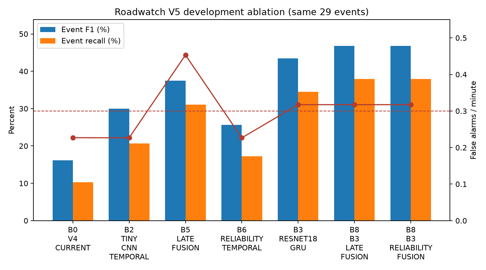

# Kết quả ablation V5

**Status tất cả dòng dưới:** `MEASURED_ON_ROADWATCH` trên cùng 29 events / 22.063 phút, trừ sai khác
làm tròn 22.060 trong artifact V4.

| Experiment | TP | FP | FN | Precision | Recall | Event F1 | FA/min |
|---|---:|---:|---:|---:|---:|---:|---:|
| B0_V4_CURRENT | 3 | 5 | 26 | 37.50% | 10.30% | 16.20% | 0.2270 |
| B2_TINY_CNN_TEMPORAL | 6 | 5 | 23 | 54.55% | 20.69% | 30.00% | 0.2266 |
| B5_LATE_FUSION | 9 | 10 | 20 | 47.37% | 31.03% | 37.50% | 0.4532 |
| B6_RELIABILITY_TEMPORAL | 5 | 5 | 24 | 50.00% | 17.24% | 25.64% | 0.2266 |
| B3_RESNET18_GRU | 10 | 7 | 19 | 58.82% | 34.48% | 43.48% | 0.3173 |
| B8_B3_LATE_FUSION | 11 | 7 | 18 | 61.11% | 37.93% | 46.81% | 0.3173 |
| B8_B3_RELIABILITY_FUSION | 11 | 7 | 18 | 61.11% | 37.93% | 46.81% | 0.3173 |

B2 vẫn được chọn vì F1 30.00% là cao nhất trong nhóm FA/min ≤0.30. B3 cải thiện rõ lên
P=58.82%, R=34.48%, F1=43.48%, nhưng 7 FP tương ứng
0.3173 FA/min, cao hơn gate đúng một FP trên 22.063 phút. B8 late fusion đạt
P=61.11%, R=37.93%, F1=46.81%, song cùng trượt FA/min.
Không tăng threshold hậu nghiệm theo heldout: sweep trên training subjects đã bão hòa và không cung cấp
bằng chứng calibration để làm vậy.

## Target gate

| Metric | Selected B2 | B8 best unconstrained | Development target | B2 pass? | B8 pass? |
|---|---:|---:|---:|---|---|
| Precision | 54.55% | 61.11% | ≥60% | NO | YES |
| Recall | 20.69% | 37.93% | ≥30% | NO | YES |
| F1 | 30.00% | 46.81% | ≥40% | NO | YES |
| FA/min | 0.2266 | 0.3173 | ≤0.30 | YES | NO |

Kết luận: giả thuyết “action branch có thể phục hồi evidence khi detector/fusion yếu” được hỗ trợ một
phần và pretrained encoder cải thiện độ nhạy, nhưng không candidate nào đạt đồng thời toàn bộ gate;
vì vậy không deploy.
