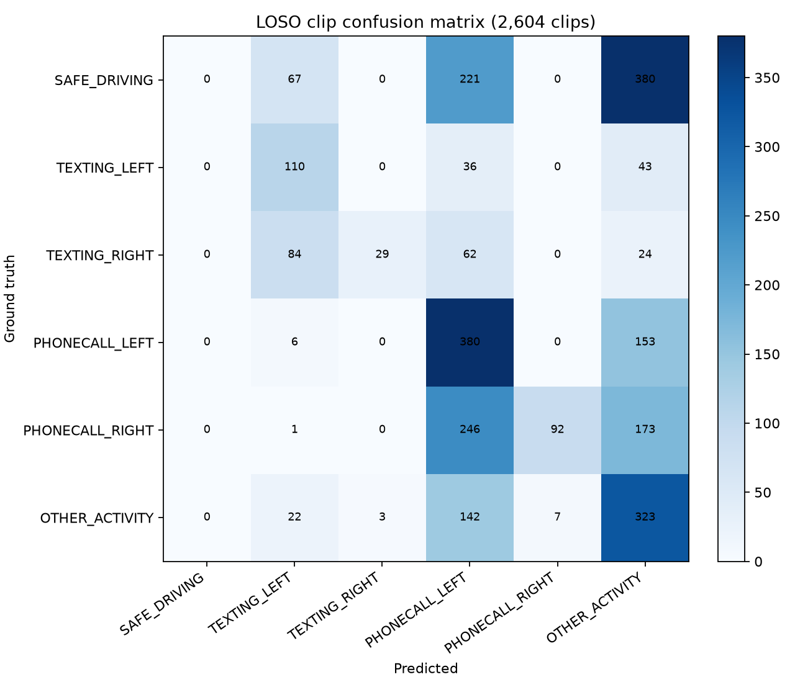

# Metrics nhánh phone

## B3 action recognition — `MEASURED_ON_ROADWATCH`

- Clip accuracy: 35.87%; macro-F1: 31.41%; evaluated clips: 2604.

| Class | Support | Precision | Recall | F1 |
|---|---:|---:|---:|---:|
| SAFE_DRIVING | 668 | 0.00% | 0.00% | 0.00% |
| TEXTING_LEFT | 189 | 37.93% | 58.20% | 45.93% |
| TEXTING_RIGHT | 199 | 90.62% | 14.57% | 25.11% |
| PHONECALL_LEFT | 539 | 34.96% | 70.50% | 46.74% |
| PHONECALL_RIGHT | 512 | 92.93% | 17.97% | 30.11% |
| OTHER_ACTIVITY | 497 | 29.47% | 64.99% | 40.55% |

| True \ Pred | SAFE_DRIVING | TEXTING_LEFT | TEXTING_RIGHT | PHONECALL_LEFT | PHONECALL_RIGHT | OTHER_ACTIVITY |
|---|---:|---:|---:|---:|---:|---:|
| SAFE_DRIVING | 0 | 67 | 0 | 221 | 0 | 380 |
| TEXTING_LEFT | 0 | 110 | 0 | 36 | 0 | 43 |
| TEXTING_RIGHT | 0 | 84 | 29 | 62 | 0 | 24 |
| PHONECALL_LEFT | 0 | 6 | 0 | 380 | 0 | 153 |
| PHONECALL_RIGHT | 0 | 1 | 0 | 246 | 92 | 173 |
| OTHER_ACTIVITY | 0 | 22 | 3 | 142 | 7 | 323 |

B3 tăng clip accuracy từ 24.43% lên 35.87% và macro-F1
từ 15.47% lên 31.41%. Tuy vậy SAFE_DRIVING recall bằng 0 và dự đoán
vẫn lệch mạnh theo subject/lớp. Riêng fold gZ-36 có event TP=2, FP=5, FN=9 và 0.5816 FA/min, cho thấy
score shift giữa subject; aggregate tốt hơn không chứng minh tổng quát hóa.

## Temporal events — selected B2

TP=6, FP=5, FN=23;
precision=54.55%, recall=20.69%, F1=30.00%,
FA/min=0.2266, mean onset latency=6.139s,
duplicates=2, fragmentation=2.

B3 action-only phục hồi 8 V4 FN;
B8 late fusion phục hồi 8 V4 FN, nhưng cả hai
đều nằm ngoài FA/min gate. Selected B2 tiếp tục phục hồi 6 V4 FN.

## Sáu V4 FN được phục hồi

| Case | Subject | Action | V4 failure | V5 predicted interval | IoU | Start latency |
|---|---|---|---|---:|---:|---:|
| gB-9-phone-01 | gB-9 | phonecall_right | CROSS_VIEW_FUSION | 49.395–57.964 | 0.287 | +9.408s |
| gB-9-phone-03 | gB-9 | phonecall_right | CROSS_VIEW_FUSION | 117.439–150.706 | 0.921 | +2.284s |
| gB-9-phone-05 | gB-9 | phonecall_left | CROSS_VIEW_FUSION | 237.399–245.968 | 0.184 | +18.011s |
| gB-9-phone-07 | gB-9 | texting_left | CROSS_VIEW_FUSION | 298.387–301.915 | 0.185 | +13.407s |
| gB-9-phone-09 | gB-9 | texting_left | PHONE_OBJECT_DETECTOR | 373.488–386.089 | 0.601 | +2.991s |
| gC-14-phone-08 | gC-14 | phonecall_left | BEHAVIORAL_CLASSIFICATION | 299.395–306.956 | 0.139 | -2.688s |

## Object detector metrics — tách riêng grain

Historical V2 YOLO11s validation (`MEASURED_ON_ROADWATCH`, component image split): precision
97.13%, recall
82.73%, mAP50
94.48%, mAP50-95
70.03%. V5 **không retrain detector** và
DMD temporal cache không có bbox ground truth để tính mAP; các số detector này không phải V5 event metrics.
